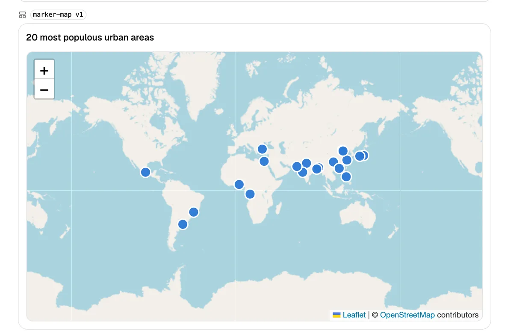
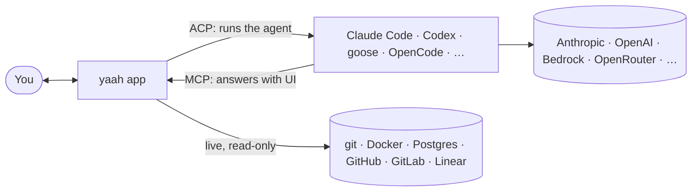

<p align="center">
  
</p>

<h1 align="center">yaah</h1>

<p align="center"><strong>Agents answer with interface.</strong></p>

<p align="center">
  A desktop app for coding agents where the answer isn't a wall of text: it's a form you fill in together,
  a live dashboard, a diff you can review, a PR you can act on.
</p>

<p align="center">
  <a href="https://filipecabaco.github.io/yaah/"><strong>Website</strong></a> ·
  <a href="https://github.com/filipecabaco/yaah/releases/latest"><strong>Download</strong></a> ·
  <a href="app/README.md"><strong>Docs</strong></a> ·
  <a href="REVIEW.md">Roadmap</a>
</p>

<p align="center">
  <picture>
    <source media="(prefers-color-scheme: dark)" srcset="site/public/shots/scenarios-map-dark.webp">
    
  </picture>
</p>

## Install

```sh
curl -fsSL https://raw.githubusercontent.com/filipecabaco/yaah/main/install.sh | sh
```

macOS (Apple silicon) and Linux (x86_64, arm64). The script verifies the release's SHA-256 before it installs anything.
`--uninstall` removes exactly what it installed. On Linux, `--deb` installs the package with apt instead.
Prefer to click? Grab the `.dmg`, `.AppImage` or `.deb` from [Releases](https://github.com/filipecabaco/yaah/releases/latest).

## Why yaah

Coding agents are great at work and terrible at showing it. They paste diffs into chat, dump JSON, describe dashboards
in prose, and ask you questions one line at a time. yaah gives them a better way to answer.

- **Real UI, built from data.** Agents render forms, tables, charts, maps, live PRs, database queries, git graphs and diffs
  straight into the chat. Components are data, not code, so nothing an agent writes ever runs in the app.
- **Work on it together.** Forms are shared: the agent fills in what it knows, you correct the rest, and it sees your edits.
- **Live, not pasted.** Point a component at your machine, Docker, Postgres (read-only), GitHub, GitLab or Linear, and it
  stays current without another agent turn. Diffs come straight from git instead of being copied token by token.
- **Any agent.** Claude Code, Codex, Gemini CLI, goose, OpenCode, GitHub Copilot, Qwen Code, Cline, Kiro, Kimi, Mistral Vibe,
  Cursor, Auggie, or any command that speaks the [Agent Client Protocol](https://agentclientprotocol.com).
- **Any model.** Run goose, OpenCode or Claude Code on **Amazon Bedrock** (your AWS profile or SSO) or **OpenRouter**, with
  keys kept in your keychain.

<table>
  <tr>
    <td width="50%">
      <picture>
        <source media="(prefers-color-scheme: dark)" srcset="site/public/shots/ask-form-dark.webp">
        
      </picture>
      <p align="center"><sub>A form you and the agent fill in together</sub></p>
    </td>
    <td width="50%">
      <picture>
        <source media="(prefers-color-scheme: dark)" srcset="site/public/shots/library-pr-view-dark.webp">
        
      </picture>
      <p align="center"><sub>A pull request, live from GitHub</sub></p>
    </td>
  </tr>
  <tr>
    <td width="50%">
      <picture>
        <source media="(prefers-color-scheme: dark)" srcset="site/public/shots/pack-system-monitor-dark.webp">
        
      </picture>
      <p align="center"><sub>This machine, live every two seconds</sub></p>
    </td>
    <td width="50%">
      <picture>
        <source media="(prefers-color-scheme: dark)" srcset="site/public/shots/pack-db-query-dark.webp">
        
      </picture>
      <p align="center"><sub>A read-only query, charted</sub></p>
    </td>
  </tr>
</table>

## What's inside

- **24 ready-made components:**
  - review: `diff-review` (files, viewed ticks, ask about any hunk), PR views, test reports;
  - git: graphs and status;
  - data: Postgres explorer, SQL editor;
  - machines: Docker dashboards, container logs, system monitor;
  - trackers: GitHub, GitLab and Linear issues, boards and cycles.
- **Your own component library.** Agents save the UI they build and improve it over versions. Copy any component, install
  libraries from git, or share yours as a library for your team.
- **Projects that start from your tracker.** Pick a GitHub, GitLab or Linear issue (or paste its link) and yaah creates
  the project, writes the issue into its brief, adds your local clone and drafts the first message.
- **Split panes.** ⌘D splits the window like a terminal; each pane runs its own chat, project or agent.
- **Switch agents mid-chat.** Hand the conversation to another agent for the next message.
- **Keyboard-first.** ⌘K for everything, with your shortcuts listed in Settings.
- **Any VS Code theme.** 65 built in, or drop your own in.

<p align="center">
  <picture>
    <source media="(prefers-color-scheme: dark)" srcset="site/public/shots/project-from-issue-dark.webp">
    
  </picture>
</p>

## Safe by design

- **Agent UI is data.** Components render with yaah's own building blocks, and web pages load only when you click.
- **Read-only by default.** Postgres runs as a read-only role (yaah refuses superusers), and every tracker integration only reads.
- **The agent asks before its tools run** (edits, commands, fetches), unless you said "don't ask again". Only yaah's own UI tools skip the prompt.
- **Secrets stay put.** Tokens are in your keychain or a 0600 file. They go only to the process that needs them, and never into an agent's command line.
- **Agent adapters are verified before they're used.** yaah installs each adapter once and checks newer versions daily. A
  new version is adopted only after a conformance suite and `npm audit` pass. You can hold any version.

## How it works



yaah runs agents over the [Agent Client Protocol](https://agentclientprotocol.com) and gives each chat its own MCP server.
Through that server, agents render UI, ask you questions and read live data. Rust owns the logic; the React UI only draws.
The full architecture is in [app/README.md](app/README.md).

## Build from source

```sh
git clone https://github.com/filipecabaco/yaah && cd yaah/app
pnpm install
pnpm tauri dev
```

This needs Rust and Node; [`mise`](https://mise.jdx.dev) installs the exact versions from `app/mise.toml`. `mise run ci`
runs the same checks as CI. `pnpm dev` runs the UI in a browser against recorded fixtures, with no agent needed.

## Status

yaah is young and moving fast: see [Releases](https://github.com/filipecabaco/yaah/releases) and the open work in
[REVIEW.md](REVIEW.md). macOS builds are ad-hoc signed for now; notarised builds are planned.
Research notes and screenshots from each change live in [`docs/`](docs/).
