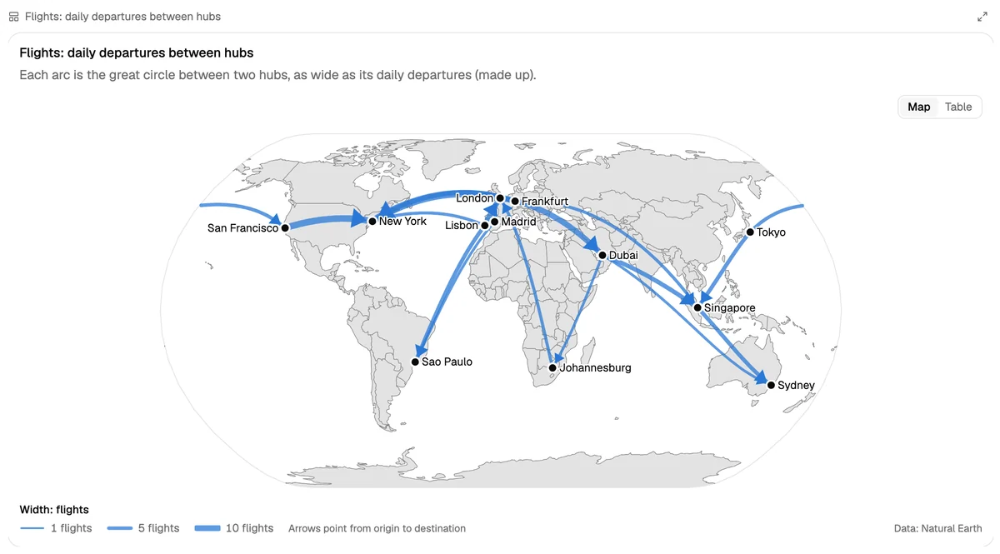
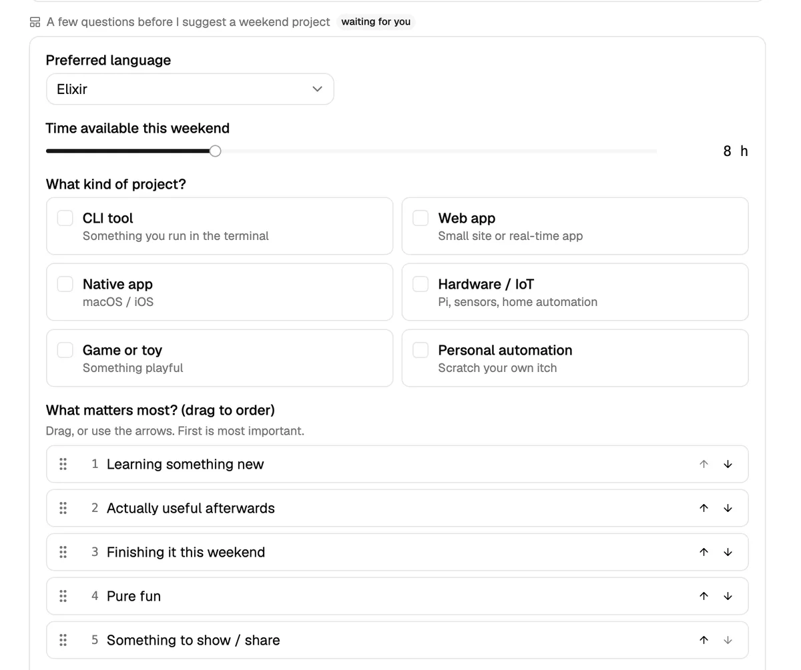
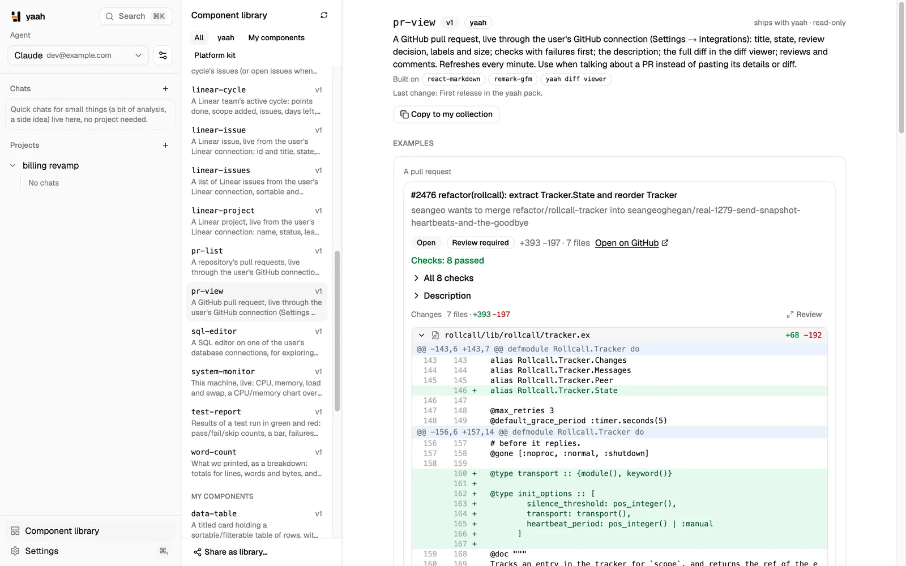
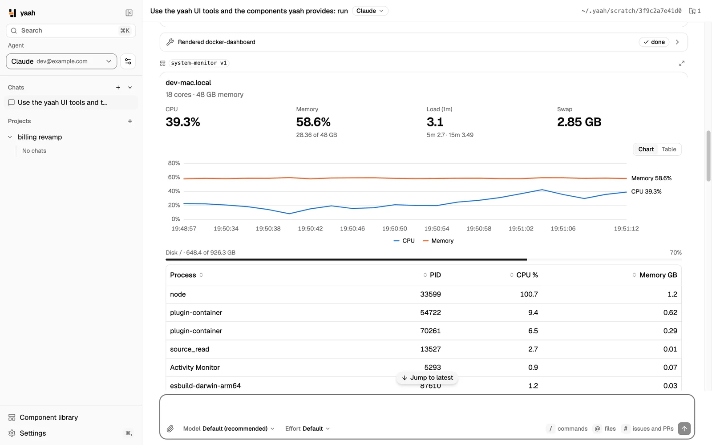
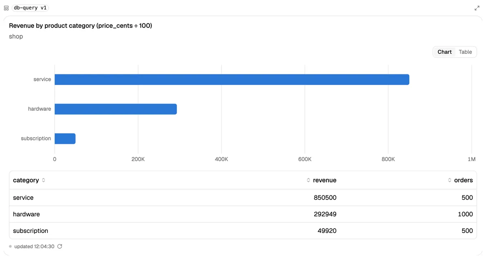
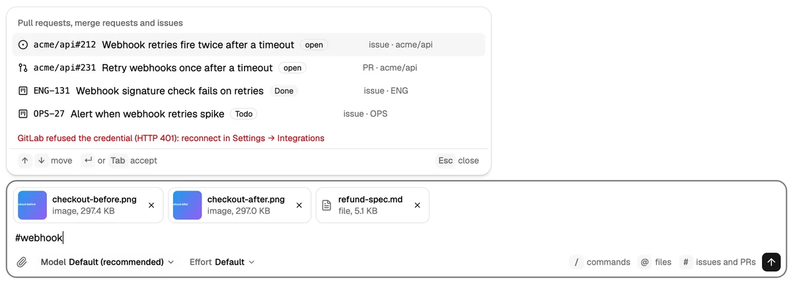
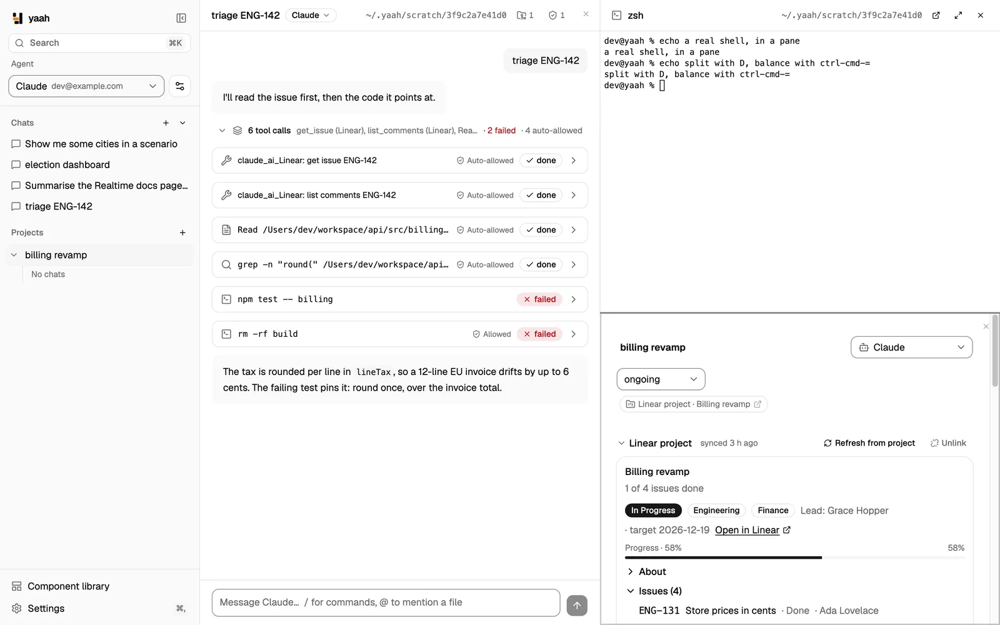
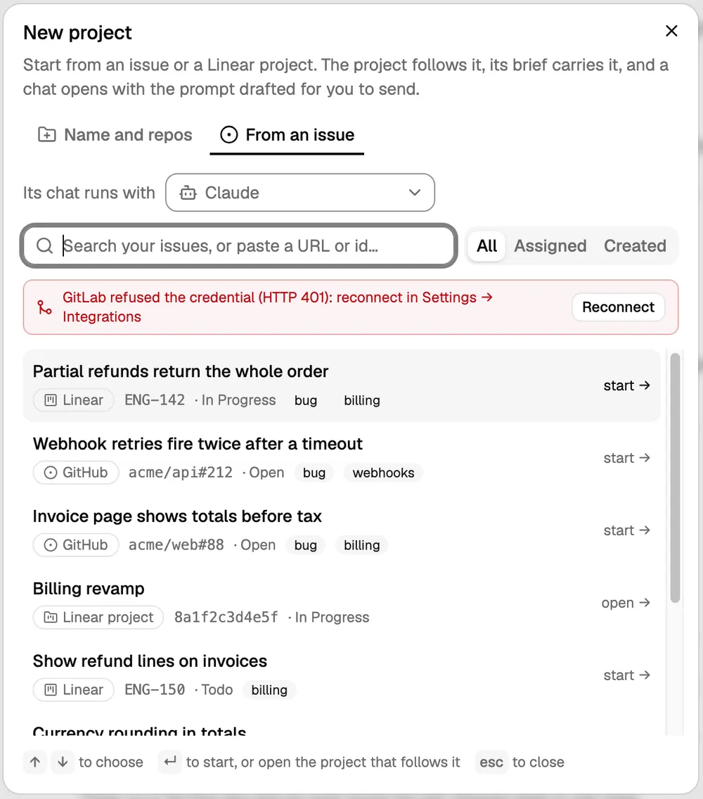

<p align="center">
  
</p>

<h1 align="center">yaah</h1>

<p align="center"><strong>Agents answer with interface.</strong></p>

<p align="center">
  A desktop app for coding agents where the answer isn't a wall of text: it's a form you fill in together,
  a live dashboard, a diff you can review, a PR you can act on.
</p>

<p align="center">
  <a href="https://filipecabaco.github.io/yaah/"><strong>Website</strong></a> ·
  <a href="https://github.com/filipecabaco/yaah/releases/latest"><strong>Download</strong></a> ·
  <a href="app/README.md"><strong>Docs</strong></a> ·
  <a href="REVIEW.md">Roadmap</a>
</p>

<p align="center">
  <picture>
    <source media="(prefers-color-scheme: dark)" srcset="site/public/shots/map-connection-dark.webp">
    
  </picture>
</p>

## Install

```sh
curl -fsSL https://raw.githubusercontent.com/filipecabaco/yaah/main/install.sh | sh
```

macOS (Apple silicon) and Linux (x86_64, arm64). The script verifies the release's SHA-256 before it installs anything.
`--uninstall` removes exactly what it installed. On Linux, `--deb` installs the package with apt instead.
Prefer to click? Grab the `.dmg`, `.AppImage` or `.deb` from [Releases](https://github.com/filipecabaco/yaah/releases/latest).

## Why yaah

Coding agents are great at work and terrible at showing it. They paste diffs into chat, dump JSON, describe dashboards
in prose, and ask you questions one line at a time. yaah gives them a better way to answer.

- **Real UI, built from data:** agents render forms, tables, charts, maps, flow graphs, MDX, live PRs, database queries,
  git graphs and diffs straight into the chat. Components are data, not code, so nothing an agent writes ever runs in the app.
- **Work on it together:** forms are shared. The agent fills in what it knows, you correct the rest, and it sees your edits.
- **Live, not pasted:** point a component at your machine, Docker, Postgres (read-only), GitHub, GitLab or Linear, and it
  stays current without another agent turn. Diffs come straight from git instead of being copied token by token.
- **Any agent:** Claude Code, Codex, Gemini CLI, goose, OpenCode, GitHub Copilot, Qwen Code, Cline, Kiro, Kimi, Mistral Vibe,
  Cursor, Auggie, or any command that speaks the [Agent Client Protocol](https://agentclientprotocol.com).
- **Any model:** run goose, OpenCode or Claude Code on **Amazon Bedrock** (your AWS profile or SSO) or **OpenRouter**, with
  keys kept in your keychain.

<table>
  <tr>
    <td width="50%">
      <picture>
        <source media="(prefers-color-scheme: dark)" srcset="site/public/shots/ask-form-dark.webp">
        
      </picture>
      <p align="center"><sub>A form you and the agent fill in together</sub></p>
    </td>
    <td width="50%">
      <picture>
        <source media="(prefers-color-scheme: dark)" srcset="site/public/shots/library-pr-view-dark.webp">
        
      </picture>
      <p align="center"><sub>A pull request, live from GitHub</sub></p>
    </td>
  </tr>
  <tr>
    <td width="50%">
      <picture>
        <source media="(prefers-color-scheme: dark)" srcset="site/public/shots/pack-system-monitor-dark.webp">
        
      </picture>
      <p align="center"><sub>This machine, live every two seconds</sub></p>
    </td>
    <td width="50%">
      <picture>
        <source media="(prefers-color-scheme: dark)" srcset="site/public/shots/pack-db-query-dark.webp">
        
      </picture>
      <p align="center"><sub>A read-only query, charted</sub></p>
    </td>
  </tr>
</table>

## What's inside

- **24 ready-made components:**
  - review: `diff-review` (files, viewed ticks, ask about any hunk), PR views, test reports;
  - git: graphs and status;
  - data: Postgres explorer, SQL editor;
  - machines: Docker dashboards, container logs, system monitor;
  - trackers: GitHub, GitLab and Linear issues, boards and cycles.
- **Charts, maps and flow graphs on d3:** bars, lines, areas and dumbbells; choropleth, bubble, connection, hexbin and outline
  maps of the world, Europe or US states, plus street maps with routes and clusters; sankey and network graphs.
- **The message box:** drop, paste or attach images and files; pick the model and effort the agent offers; type `#`,
  `github#`, `gitlab#` or `linear#` to attach an issue or PR, and the agent is told which live viewer shows it; lists continue on
  Shift+Enter and ⌘B / ⌘I / ⌘E format a selection. Send while the agent is busy and the message waits in a queue.
- **Your own component library:** agents save the UI they build and improve it over versions. Copy any component, install
  libraries from git, or share yours as a library for your team.
- **Projects that start from your tracker:** pick a GitHub, GitLab or Linear issue (or paste its link) and yaah creates
  the project, writes the issue into its brief, adds your local clone and drafts the first message.
- **Split panes, terminals and diffs:** ⌘D / ⌘⇧D split the window like a terminal, ⌃⌘= balances the panes, and ⌘W on the
  last pane goes home. A pane holds a chat, a project, your login shell (⌘T) or a read-only diff of a repo (all changes, staged,
  unstaged, or against a branch). Open terminals and diffs are listed in the sidebar, under their project when opened from one.
- **Open in terminal, and agents' commands live:** open any folder in Ghostty, iTerm or Terminal. When an agent runs its commands
  through ACP's terminal capability, the tool card shows them live. (Claude Code's and Codex's current adapters run their own
  commands and don't use it yet.)
- **Resume a session…** Import a session you started in the Claude Code or Codex CLI and carry on in yaah.
- **A calmer chat:** full-width, your message on the right and the agent's reply in a soft bubble. Runs of tool calls fold into
  one row, screenshots agents take show inline, a chat opens at its latest message, and any rendered UI has an Expand button that
  fills a dialog.
- **Fewer permission prompts:** reads inside the chat's folders are allowed without asking, an MCP server can be trusted in one
  chat, a project, all quick chats or every chat, "don't ask again" is remembered, and answered requests fold into chips on the
  tool cards. Web searches can be allowed in Settings. Edits, commands and fetches still ask.
- **Switch agents mid-chat:** hand the conversation to another agent for the next message.
- **Keyboard-first:** ⌘K lists chats, then projects, then commands (`@` or `#` narrows it), and your shortcuts are listed in
  Settings. Chat and project rows have Rename and Delete buttons.
- **Any VS Code theme:** 65 built in, or drop your own in. Text keeps at least 4.5:1 contrast in every theme, chart colours follow the
  theme, and the home screen scores 100 in Lighthouse accessibility.
- **Your fonts:** pick an interface font and a code font and their sizes; they apply everywhere, terminals included.
  The two sizes are linked unless you unlink them, and ⌘= / ⌘- / ⌘0 change them from anywhere.
- **Your model account:** goose, OpenCode and Claude Code can run on Amazon Bedrock or OpenRouter.

<p align="center">
  <picture>
    <source media="(prefers-color-scheme: dark)" srcset="site/public/shots/composer-references-dark.webp">
    
  </picture>
</p>

<p align="center">
  <picture>
    <source media="(prefers-color-scheme: dark)" srcset="site/public/shots/split-panes-dark.webp">
    
  </picture>
</p>

<p align="center">
  <picture>
    <source media="(prefers-color-scheme: dark)" srcset="site/public/shots/project-from-issue-dark.webp">
    
  </picture>
</p>

## Safe by design

- **Agent UI is data:** components render with yaah's own building blocks, and web pages load only when you click.
- **Read-only by default:** Postgres runs as a read-only role (yaah refuses superusers), and every tracker integration only reads.
- **The agent asks before its tools run** (edits, commands, fetches), unless you said "don't ask again", the call is a read inside the chat's folders, or it comes from an MCP server you trusted. Only yaah's own UI tools skip the prompt.
- **MDX never runs:** yaah parses its syntax only and never evaluates imports, expressions or scripts.
- **Secrets stay put:** tokens are in your keychain or a 0600 file. They go only to the process that needs them, and never into an agent's command line.
- **Agent adapters are verified before they're used:** yaah installs each adapter once and checks newer versions daily. A
  new version is adopted only after a conformance suite and `npm audit` pass. You can hold any version.

## How it works


yaah runs agents over the [Agent Client Protocol](https://agentclientprotocol.com) and gives each chat its own MCP server.
Through that server, agents render UI, ask you questions and read live data. Rust owns the logic; the React UI only draws.
The full architecture is in [app/README.md](app/README.md).

## Build from source

```sh
git clone https://github.com/filipecabaco/yaah && cd yaah/app
pnpm install
pnpm tauri dev
```

This needs Rust and Node; [`mise`](https://mise.jdx.dev) installs the exact versions from `app/mise.toml`. `mise run ci`
runs the same checks as CI. `pnpm dev` runs the UI in a browser against recorded fixtures, with no agent needed.

## Status

yaah is young and moving fast: see [Releases](https://github.com/filipecabaco/yaah/releases) and the open work in
[REVIEW.md](REVIEW.md). macOS builds are ad-hoc signed for now; notarised builds are planned.
Research notes and screenshots from each change live in [`docs/`](docs/).
